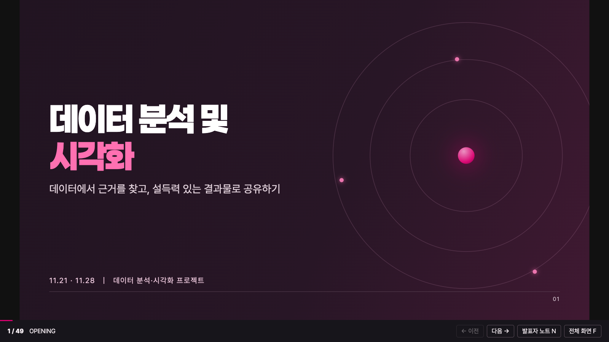

# 데이터 분석 및 시각화 특강



## 발표 자료 사용

[`index.html`](index.html)을 Chrome 등 브라우저에서 열면 49장짜리 16:9 발표 자료가 실행됩니다. 인터넷 연결 없이 슬라이드와 글꼴을 볼 수 있습니다. 통신사 시연 화면을 열려면 `결과물/` 폴더도 함께 두어야 합니다.

- `←` / `→` 또는 스페이스바: 슬라이드 이동
- `Home` / `End`: 처음 / 마지막 슬라이드
- `F`: 전체 화면, `B`: 검은 화면, `R`: 현재 슬라이드 다시 표시
- `N`: 발표자 노트. 노트 수정 내용은 현재 브라우저에 저장되며 JSON으로 내려받거나 다시 불러올 수 있습니다.
- 실습 질문의 **내용 보기**: 전체 문장 확인. **프롬프트 복사**: 질문 하나의 문장만 일반 텍스트로 복사.

## 구성과 편집 기준

원고의 큰 순서를 유지했습니다: **프로젝트 결과 시연 → 1일차 분석·실습 → 텍스트 마이닝 → 프로젝트 실습 → 2일차 HTML·Agent → GitHub 자료 받기**. 숙명여자대학교 특강 HTML의 16:9 고정 무대, 진한 자주색 장 표지, 밝은 본문, 큰 제목, 분홍 강조, 단계적 등장, 하단 발표 도구를 참고했습니다.

| 원고에서 편집한 부분 | 발표 자료의 처리 |
| --- | --- |
| 뷰티 시연 결과물 | 아직 완성본이 없어 위치와 교체 안내만 두었습니다. 분석 수치나 결론을 임의로 만들지 않았습니다. |
| Spotify·housing·population 실습 | 실제 CSV를 읽고 나온 행 수·결측치·예시 수치를 사용했습니다. 질문별로 복사 버튼을 붙였습니다. |
| `housing.csv` 질문 번호 | 2부터 시작하던 번호를 슬라이드 안에서 1부터 다시 매겼습니다. |
| `population.csv`의 시간 추세·원형 그래프 | 한 시점의 연령 구조는 시간 추세로 부르지 않았습니다. 연령대가 많아 비교하기 쉬운 막대그래프를 사용했습니다. |
| `65세 이상` 비중 | 제공된 파일은 10세 구간이므로 정확히 구할 수 없습니다. 70세 이상 비중 질문으로 바꾸고 그 이유를 밝혔습니다. |
| 인사이트의 “높은 이유” | 현재 표만으로 원인을 단정하지 않도록 관찰·가능한 설명·추가 검증을 분리했습니다. |
| 텍스트 마이닝 | 중복된 기법 목록을 줄이고 영어 짧은 문장 데이터에 맞는 VADER 감성 분석으로 범위를 좁혔습니다. 원문 문장 분류와 별도의 단어 집계를 구분했습니다. |
| Git 명령 | 초심자에게 간단한 `git clone` → `cd` → 이후 `git pull` 순서로 정리했습니다. |

감성 분석 실습의 `predicted_sentiment`와 `cleaned_text`는 원본 CSV에 없는 열입니다. 강의 중 생성합니다. [VADER 공식 프로젝트](https://github.com/cjhutto/vaderSentiment)의 기준을 사용하되, 분류 결과를 실제 감정의 정답으로 간주하지 않고 문장 표본을 확인하도록 안내합니다.

## 파일과 수정 방법

- `presentation_source.py`: 슬라이드 문구, 프롬프트, 발표자 노트
- `presentation.css`: 배치, 색상, 타이포그래피
- `presentation.js`: 이동, 복사, 발표자 노트, 전체 화면
- `build_presentation.py`: 위 소스와 내장 글꼴·시연 이미지를 `index.html` 하나로 묶음
- `실습/`: 실습 데이터, 재현 코드와 실행 안내
- `프로젝트/`: 통신사·뷰티 프로젝트 자료
- `결과물/`: 통신사 시연 결과 HTML
- `prepare_public_release.py`: 공개 GitHub 사본을 만들 때 YouTube 자료의 연락처 문자열을 가림

문구나 디자인을 바꾼 뒤 다음 명령으로 발표 HTML을 다시 만듭니다.

```bash
python3 build_presentation.py
```

뷰티 결과물이 준비되면 `presentation_source.py`의 **2026 뷰티 트렌드 분석** 슬라이드에 화면과 링크를 넣고 다시 빌드하면 됩니다. Agent 설치 절차는 수강생이 사용할 제품과 환경이 확정되면 **Agent 환경 구성** 뒤에 추가할 수 있습니다.

글꼴은 Paperlogy와 Pretendard를 발표 HTML에 포함했습니다. 출처는 `assets/fonts.css` 첫 줄에, 저작권 고지와 사용 조건은 `assets/licenses/`에 있습니다.

공개 GitHub 사본에서는 뷰티 YouTube 수집 파일의 이메일과 휴대전화 번호 형태 문자열을 `[email removed]`, `[phone removed]`로 바꿉니다. 로컬 원본은 수정하지 않습니다. 공개 자료는 수집된 텍스트의 재배포본이므로 실습 외 용도로 사용할 때는 원 출처의 조건을 확인하세요.
